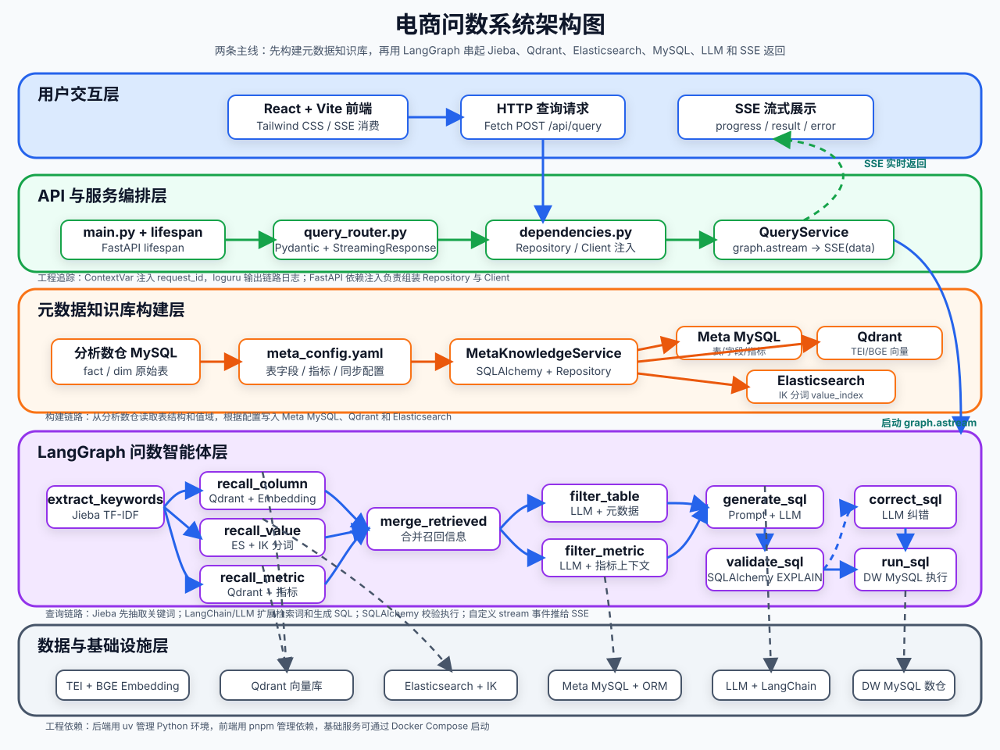

<div align='center'>
  <h1 style="margin-top: 15px;">「电商问数」智能数据分析 Agent</h1>
  <h4><b>qi-bao-nl2sql-agent</b></h4>
  <p><em>基于 LangGraph 的 NL2SQL 智能问数系统：元数据知识库 + 字段/指标/取值混合检索 + 多阶段推理 + SQL 生成校验执行全链路</em></p>
</div>

<div align='center'>


[快速开始](#quick-start) • [项目介绍](#project-introduction) • [项目亮点](#features) • [系统架构](#architecture) • [项目结构](#structure) • [配套教程](#tutorials) • [常见问题](#faq) • [来源与许可](#license)

</div>

**📢 说明**：这是一个可以直接跑起来的完整项目，不是只调用一次大模型接口的 Demo。

它围绕电商数仓问数场景，先构建元数据知识库，再做字段、指标、字段取值的混合检索，随后用 `LangGraph` 编排多阶段问数流程，完成 SQL 生成、校验、修正、执行和前端流式展示。换句话说，这里覆盖的是 AI 应用从数据准备、检索增强、智能体编排、接口交付到前端联调的完整工程主线。

> **来源与改编说明**：本项目为学习实践项目，思路与初始版本来源于 [ai-agents-from-zero](https://github.com/didilili/ai-agents-from-zero) 教程体系中的 [实战项目-电商问数](https://github.com/didilili/ai-agents-from-zero/tree/main/%E5%AE%9E%E6%88%98%E9%A1%B9%E7%9B%AE-%E7%94%B5%E5%95%86%E9%97%AE%E6%95%B0)，业务原型参考自尚硅谷「大模型智能体掌柜问数」课程。本仓库在其基础上对配置管理、文档结构与开源工程化做了调整。原始代码版权归原作者所有，遵循 MIT 协议，详见 [来源与许可](#license)。


<a id="project-introduction"></a>

## 📖 项目介绍

在真实问数场景里，业务同学通常不会写 SQL，数据分析同学也很难随时记住所有表结构、字段含义、指标口径和字段取值。单纯把自然语言问题直接交给大模型，很容易出现表选错、字段选错、指标理解错和 SQL 幻觉等问题。

`电商问数` 要解决的就是这个问题：

- 用户用自然语言提问
- 系统自动召回相关字段、指标和字段取值
- 大模型基于上下文进行分步推理
- 生成 SQL 并查询数据仓库
- 以流式方式返回分析结果

<a id="features"></a>

## ✨ 项目亮点

- **检索 + 推理 + 生成，而不是模型直出 SQL**
    - 先围绕问题召回相关字段、指标和值域，再组织上下文生成 SQL，整体链路更稳、更可控。
- **面向企业问数场景的混合检索**
    - `Qdrant` 负责字段和指标的语义召回。
    - `Elasticsearch` 负责字段取值的全文检索。
    - `MySQL` 负责保存完整、权威的结构化元数据。
- **支持字段、指标、取值三类信息协同召回**
    - 比单纯做表级或字段级检索更贴近真实企业分析流程。
- **从检索到执行的完整可运行链路**
    - 不停留在 Prompt 设计，而是会真实生成 SQL、执行查询，并以流式方式返回结果。
- **工程化后端结构清晰**
    - 基于 `FastAPI + LangGraph + Repository + Client Manager` 组织配置、客户端、仓储层、服务层与智能体流程，便于维护和扩展。
- **可按章节对照学习**
    - 原作者提供了与该流程对应的系统化免费讲义，可按「数仓基础 → 元数据知识库 → 问数智能体」的顺序逐段对照源码，入口见 [配套教程](#tutorials)。
- **兼顾学习价值与可扩展性**
    - 既可以按教程章节逐步理解，也可以在此基础上继续扩展权限控制、SQL 审核、结果可视化等能力。

这套课程十分适合这些场景：

- 想系统学习 `LangGraph`，但不想只停留在几个玩具节点。
- 想把 `MySQL`、`Qdrant`、`Elasticsearch` 和大模型放到同一个业务场景里理解。
- 想做一个比简单模型调用更接近实际开发的 AI Agent 项目。
- 想把项目写进简历，并且能说清楚数据层、检索层、智能体层、服务层和前端层分别做了什么。

<a id="architecture"></a>

## 🏗️ 系统架构



项目围绕两条主线展开：

| 主线             | 做什么                                                                   | 涉及模块                                     |
| ---------------- | ------------------------------------------------------------------------ | -------------------------------------------- |
| 元数据知识库构建 | 抽取教学数仓中的表、字段、指标和字段取值，写入结构化库、向量库和全文索引 | `MySQL` / `Qdrant` / `Elasticsearch` / `TEI` |
| 自然语言问数     | 基于用户问题完成召回、上下文整理、SQL 生成校验执行，并把过程流式返回前端 | `LangGraph` / `FastAPI` / `SSE` / `React`    |


## 🛠️ 项目技术栈

| 模块       | 技术                              | 作用                                           |
| ---------- | --------------------------------- | ---------------------------------------------- |
| 教学数仓   | `MySQL`                           | 模拟事实表、维度表和分析型查询环境             |
| 元数据库   | `MySQL` / `SQLAlchemy`            | 保存表、字段、指标、字段指标关系等结构化元数据 |
| 向量检索   | `Qdrant`                          | 保存字段和指标向量，支持语义召回               |
| 全文检索   | `Elasticsearch`                   | 保存字段真实取值，支持关键词和值域检索         |
| Embedding  | `TEI` / `BAAI/bge-large-zh-v1.5`  | 将字段、指标、问题等文本转成向量               |
| 智能体编排 | `LangGraph`                       | 组织多阶段问数工作流                           |
| 模型接入   | `LangChain`                       | 封装 LLM 与 Embedding 调用                     |
| 后端接口   | `FastAPI`                         | 提供问数 API、依赖注入和生命周期管理           |
| 流式协议   | `SSE`                             | 实时返回节点进度、查询结果和错误消息           |
| 前端       | `React` / `Vite` / `Tailwind CSS` | 提供聊天式问数界面和流程展示                   |
| 日志追踪   | `ContextVar` / `loguru`           | 为并发请求注入 request_id，便于排查链路        |
| 依赖管理   | `uv` / `pnpm`                     | 管理 Python 后端和前端依赖                     |

<a id="structure"></a>

## 📁 项目结构

```text
qi-bao-nl2sql-agent/
├── app/
│   ├── agent/            # LangGraph 图、状态、上下文和各类节点
│   ├── api/              # FastAPI 路由、依赖注入、生命周期和请求结构
│   ├── clients/          # MySQL、Qdrant、Elasticsearch、Embedding 客户端管理
│   ├── conf/             # 配置 dataclass 与配置加载工具
│   ├── core/             # 日志、request_id 上下文等通用能力
│   ├── entities/         # 更贴近业务语义的数据对象
│   ├── models/           # SQLAlchemy ORM 模型
│   ├── prompt/           # Prompt 加载工具
│   ├── repositories/     # MySQL、Qdrant、Elasticsearch 数据访问层
│   ├── scripts/          # 元数据知识库构建脚本
│   └── services/         # 元数据构建服务和问数查询服务
├── conf/                 # app_config.yaml、meta_config.yaml
├── docker/               # Docker Compose、MySQL 初始化 SQL、ES 插件、Embedding 挂载目录
├── docs/images/          # README 引用的架构图与界面截图
├── examples/             # 独立可运行的小示例（如 Qdrant 快速入门）
├── frontend/             # React + Vite + Tailwind CSS 前端项目
├── prompts/              # SQL 生成、修正、过滤等 Prompt 模板
├── .env.example          # 环境变量模板（大模型 Key 与数据库连接）
├── main.py               # FastAPI 应用入口
└── pyproject.toml        # Python 项目依赖与工具配置
```

<a id="quick-start"></a>

## 🚀 快速开始

当前仓库已经包含一套可直接启动的本地开发环境，你可以按照以下顺序启动项目。

### 1. 准备环境

| 依赖 | 版本要求 | 说明 |
| --- | --- | --- |
| Python | `>= 3.12` | 开发与验证环境为 3.14.3 |
| uv | 最新稳定版 | Python 依赖管理 |
| Docker + Compose | 支持 `compose` 子命令 | 运行 MySQL / Elasticsearch / Qdrant / TEI |
| Node.js | `>= 18` | 前端构建 |
| pnpm | `>= 9` | 前端依赖管理（无 pnpm 时可用 npm 代替） |

> 首次启动需要拉取约 1.5 GB 镜像，并额外下载 1.3 GB 嵌入模型，请预留磁盘空间与下载时间。

### 2. 克隆项目

```bash
git clone https://github.com/qi-bao258/qi-bao-nl2sql-agent.git
cd qi-bao-nl2sql-agent
```

### 3. 安装后端依赖

```bash
uv sync
```

### 4. 配置环境变量

```bash
cp .env.example .env
```

编辑 `.env`，至少填写大模型 Key：

```bash
LLM_API_KEY=your_real_api_key
```

`.env` 同时被两处读取：后端通过 `python-dotenv` 加载（`app/conf/app_config.py`），Docker Compose 通过 `--env-file` 加载。因此数据库账号与端口**只维护这一份**，两端自动一致。

| 变量 | 默认值 | 用途 |
| --- | --- | --- |
| `LLM_API_KEY` | 无 | 大模型 API Key，必填 |
| `DB_HOST` | `localhost` | 后端连接 MySQL 的主机 |
| `DB_PORT` | `3306` | 后端连接端口，同时作为容器端口映射 |
| `DB_USER` | `shopkeeper` | 应用数据库账号 |
| `DB_PASSWORD` | `change_me_local_only` | 应用数据库口令 |
| `MYSQL_ROOT_PASSWORD` | `change_me_root` | 容器 root 口令，仅容器初始化使用 |

> 以上默认口令仅用于本地教学环境，请勿用于公网或生产部署。

默认对接硅基流动，配置位于 `conf/app_config.yaml`：

```yaml
llm:
  model_name: zai-org/GLM-5.3
  api_key: ${oc.env:LLM_API_KEY}
  base_url: https://api.siliconflow.cn/v1
```

如需使用其他兼容 OpenAI 接口的平台，修改 `model_name` 与 `base_url` 即可。若报 `Model disabled`，说明该模型已被上游下线，可用 `GET /v1/models` 查询当前账号可用的模型名。

### 5. 准备 Embedding 模型

`TEI` 容器需要加载 `BAAI/bge-large-zh-v1.5`。模型目录体积约 1.3 GB（其中 `pytorch_model.bin` 单文件 1.2 GB），已通过 `.gitignore` 排除，不会随仓库分发，需自行下载到挂载路径：

```bash
uv run hf download BAAI/bge-large-zh-v1.5 --local-dir docker/embedding/bge-large-zh-v1.5
```

国内网络直连 `huggingface.co` 容易超时，使用镜像站：

```bash
HF_ENDPOINT=https://hf-mirror.com uv run hf download BAAI/bge-large-zh-v1.5 --local-dir docker/embedding/bge-large-zh-v1.5
```

Windows PowerShell 写法：

```powershell
$env:HF_ENDPOINT = "https://hf-mirror.com"
uv run hf download BAAI/bge-large-zh-v1.5 --local-dir docker/embedding/bge-large-zh-v1.5
```

下载完成后确认目录中存在 `config.json` 与 `pytorch_model.bin`。缺少 `config.json` 时，`embedding` 容器会因 `config.json not found` 反复重启。

### 6. 启动 Docker 基础服务

```bash
docker compose -f docker/docker-compose.yaml --env-file .env up -d --build
```

> `--env-file .env` 不可省略。Compose 的 project directory 是 `docker/`，默认只读 `docker/.env`；不加该参数时，端口与数据库账号会回落到默认值，与 `.env` 里的配置不一致。

默认端口：

| 服务          | 宿主端口 | 说明 |
| ------------- | -------- | ---- |
| MySQL         | `3306`   | 可用 `DB_PORT` 覆盖 |
| Elasticsearch | `9200`   | 单节点，关闭安全认证 |
| Kibana        | `5601`   | 可选，用于查看索引 |
| Qdrant        | `6333`   | HTTP，`6334` 为 gRPC |
| Embedding     | `8081`   | TEI，CPU 模式 |

`docker/mysql/meta.sql` 与 `dw.sql` 只在 **MySQL 数据卷为空时**执行。若复用了旧数据卷，初始化会被跳过，`meta` 库可能不存在，表现为第 7 步构建时报错。此时先清理数据卷再重建：

```bash
docker compose -f docker/docker-compose.yaml --env-file .env down -v
docker compose -f docker/docker-compose.yaml --env-file .env up -d
```

> `down -v` 会同时删除 MySQL、Elasticsearch、Qdrant 的数据卷，仅用于本地重置。

`embedding` 服务首次启动需要预热模型，CPU 环境下约 1~2 分钟。预热期间 `8081` 端口能建立 TCP 连接但不返回响应，属正常现象，不是服务挂死。确认就绪：

```bash
curl -s -o /dev/null -w "%{http_code}\n" http://127.0.0.1:8081/health
```

返回 `200` 后再继续下一步。

### 7. 构建元数据知识库

```bash
uv run python -m app.scripts.build_meta_knowledge -c conf/meta_config.yaml
```

这一步会把表字段元数据写入 MySQL，把字段和指标向量写入 Qdrant，并把字段真实取值写入 Elasticsearch。

### 8. 启动后端

```bash
uv run fastapi dev main.py
```

后端接口：

```text
POST http://127.0.0.1:8000/api/query
```

请求示例：

```json
{
    "query": "统计华北地区的销售总额"
}
```

SSE 消息类型：

| 类型       | 含义         |
| ---------- | ------------ |
| `progress` | 节点执行进度 |
| `result`   | 最终查询结果 |
| `error`    | 全局异常消息 |

### 9. 启动前端

```bash
cd frontend
pnpm install
pnpm dev
```

页面地址：`http://127.0.0.1:5173`。

前端通过 Vite 代理把 `/api` 转发到后端，默认目标为 `http://127.0.0.1:8000`。若后端换了端口（例如 8000 被其他服务占用后改用 8001），修改前端环境变量：

```bash
cd frontend
cp .env.example .env
```

```bash
VITE_DEV_PROXY_TARGET=http://127.0.0.1:8001
```

> 前端以 pnpm 为唯一包管理器（`package.json` 已声明 `packageManager`）。混用 npm 会额外生成 `package-lock.json`，与 `pnpm-lock.yaml` 冲突。

<a id="faq"></a>

## ❓ 常见问题

| 现象 | 原因 | 处理 |
| --- | --- | --- |
| `bind: Only one usage of each socket address` | 宿主 3306 已被本机 MySQL 服务占用 | 在 `.env` 设 `DB_PORT=13306`，容器映射与后端连接会同步变化 |
| 构建元数据时报 `Unknown database 'meta'` | 复用了非空 MySQL 数据卷，initdb 脚本被跳过 | `docker compose -f docker/docker-compose.yaml --env-file .env down -v` 后重新 `up -d` |
| `embedding` 反复重启，日志报 `config.json not found` | 模型目录为空或下载未完成 | 按第 5 步重新下载，确认 `config.json` 与 `pytorch_model.bin` 存在 |
| 请求 `8081/health` 无响应 | TEI 正在预热模型 | 等待 1~2 分钟，返回 `200` 后再继续 |
| LLM 调用返回 `Model disabled` | 配置的模型已被上游下线 | 用 `GET /v1/models` 查可用模型，修改 `model_name` |
| `uv sync` 长时间无进展 | 环境变量 `HTTP_PROXY` 劫持了下载 | 清除代理变量后重试，或改用国内镜像源 |
| 问数结果为空或字段选错 | 元数据知识库未构建 | 执行第 7 步，并确认 MySQL、Qdrant、Elasticsearch 三处均有数据 |

<a id="tutorials"></a>

## 📚 配套教程目录

教程总入口：[电商问数完整教程](https://didilili.github.io/ai-agents-from-zero/#/%E5%AE%9E%E6%88%98%E9%A1%B9%E7%9B%AE-%E7%94%B5%E5%95%86%E9%97%AE%E6%95%B0/0-%E5%89%8D%E8%A8%80)

| 章节 | 标题                                                                                                                                                                                                                                                                              | 学习重点                                                                 | 对应分支                           |
| ---- | --------------------------------------------------------------------------------------------------------------------------------------------------------------------------------------------------------------------------------------------------------------------------------- | ------------------------------------------------------------------------ | ---------------------------------- |
| 0    | [前言](https://didilili.github.io/ai-agents-from-zero/#/%E5%AE%9E%E6%88%98%E9%A1%B9%E7%9B%AE-%E7%94%B5%E5%95%86%E9%97%AE%E6%95%B0/0-%E5%89%8D%E8%A8%80)                                                                                                                           | 项目定位、学习价值与能力边界                                             | `-`                                |
| 1    | [项目概述与数仓基础](https://didilili.github.io/ai-agents-from-zero/#/%E5%AE%9E%E6%88%98%E9%A1%B9%E7%9B%AE-%E7%94%B5%E5%95%86%E9%97%AE%E6%95%B0/1-%E9%A1%B9%E7%9B%AE%E6%A6%82%E8%BF%B0%E4%B8%8E%E6%95%B0%E4%BB%93%E5%9F%BA%E7%A1%80)                                              | 业务库、数仓、事实表、维度表与教学数仓设计                               | `-`                                |
| 2    | [项目整体架构与智能体流程](https://didilili.github.io/ai-agents-from-zero/#/%E5%AE%9E%E6%88%98%E9%A1%B9%E7%9B%AE-%E7%94%B5%E5%95%86%E9%97%AE%E6%95%B0/2-%E9%A1%B9%E7%9B%AE%E6%95%B4%E4%BD%93%E6%9E%B6%E6%9E%84%E4%B8%8E%E6%99%BA%E8%83%BD%E4%BD%93%E6%B5%81%E7%A8%8B)             | MySQL、Qdrant、Elasticsearch、LLM 与 Agent 工作流如何协作                | `-`                                |
| 3    | [开发环境与基础服务准备](https://didilili.github.io/ai-agents-from-zero/#/%E5%AE%9E%E6%88%98%E9%A1%B9%E7%9B%AE-%E7%94%B5%E5%95%86%E9%97%AE%E6%95%B0/3-%E5%BC%80%E5%8F%91%E7%8E%AF%E5%A2%83%E4%B8%8E%E5%9F%BA%E7%A1%80%E6%9C%8D%E5%8A%A1%E5%87%86%E5%A4%87)                        | uv、Docker Compose、MySQL、Qdrant、Elasticsearch、Kibana、Embedding 服务 | `03-env-services`                  |
| 4    | [项目结构与基础服务配置管理](https://didilili.github.io/ai-agents-from-zero/#/%E5%AE%9E%E6%88%98%E9%A1%B9%E7%9B%AE-%E7%94%B5%E5%95%86%E9%97%AE%E6%95%B0/4-%E9%A1%B9%E7%9B%AE%E7%BB%93%E6%9E%84%E4%B8%8E%E5%9F%BA%E7%A1%80%E6%9C%8D%E5%8A%A1%E9%85%8D%E7%BD%AE%E7%AE%A1%E7%90%86)  | 工程结构、YAML 配置、OmegaConf 与 dataclass 配置加载                     | `04-structure-config`              |
| 5    | [Qdrant 与 ES 快速入门与接入](https://didilili.github.io/ai-agents-from-zero/#/%E5%AE%9E%E6%88%98%E9%A1%B9%E7%9B%AE-%E7%94%B5%E5%95%86%E9%97%AE%E6%95%B0/5-Qdrant%E4%B8%8EES%E5%BF%AB%E9%80%9F%E5%85%A5%E9%97%A8%E4%B8%8E%E6%8E%A5%E5%85%A5)                                      | 向量检索、全文检索与客户端管理                                           | `05-qdrant-es`                     |
| 6    | [MySQL、Embedding 接入与日志管理](https://didilili.github.io/ai-agents-from-zero/#/%E5%AE%9E%E6%88%98%E9%A1%B9%E7%9B%AE-%E7%94%B5%E5%95%86%E9%97%AE%E6%95%B0/6-MySQL%E3%80%81Embedding%E4%B8%8E%E6%97%A5%E5%BF%97%E7%AE%A1%E7%90%86)                                              | 异步 MySQL、TEI Embedding、loguru 日志                                   | `06-mysql-embedding-log`           |
| 7    | [元数据知识库总览与构建入口](https://didilili.github.io/ai-agents-from-zero/#/%E5%AE%9E%E6%88%98%E9%A1%B9%E7%9B%AE-%E7%94%B5%E5%95%86%E9%97%AE%E6%95%B0/7-%E5%85%83%E6%95%B0%E6%8D%AE%E7%9F%A5%E8%AF%86%E5%BA%93%E6%80%BB%E8%A7%88%E4%B8%8E%E6%9E%84%E5%BB%BA%E5%85%A5%E5%8F%A3)  | 元数据知识库产物、存储分工和构建入口                                     | `07-metadata-base-overview`        |
| 8    | [表与字段信息同步到元数据库](https://didilili.github.io/ai-agents-from-zero/#/%E5%AE%9E%E6%88%98%E9%A1%B9%E7%9B%AE-%E7%94%B5%E5%95%86%E9%97%AE%E6%95%B0/8-%E8%A1%A8%E4%B8%8E%E5%AD%97%E6%AE%B5%E4%BF%A1%E6%81%AF%E5%90%8C%E6%AD%A5%E5%88%B0%E5%85%83%E6%95%B0%E6%8D%AE%E5%BA%93)  | Service、Repository、Mapper、ORM 如何配合入库                            | `08-metadata-table-column-sync`    |
| 9    | [字段与指标检索能力构建](https://didilili.github.io/ai-agents-from-zero/#/%E5%AE%9E%E6%88%98%E9%A1%B9%E7%9B%AE-%E7%94%B5%E5%95%86%E9%97%AE%E6%95%B0/9-%E5%AD%97%E6%AE%B5%E4%B8%8E%E6%8C%87%E6%A0%87%E6%A3%80%E7%B4%A2%E8%83%BD%E5%8A%9B%E6%9E%84%E5%BB%BA)                        | 字段向量索引、字段值全文索引和指标向量索引                               | `09-metadata-retrieval-capability` |
| 10   | [问数智能体总览与工作流骨架](https://didilili.github.io/ai-agents-from-zero/#/%E5%AE%9E%E6%88%98%E9%A1%B9%E7%9B%AE-%E7%94%B5%E5%95%86%E9%97%AE%E6%95%B0/10-%E9%97%AE%E6%95%B0%E6%99%BA%E8%83%BD%E4%BD%93%E6%80%BB%E8%A7%88%E4%B8%8E%E5%B7%A5%E4%BD%9C%E6%B5%81%E9%AA%A8%E6%9E%B6) | LangGraph 工作流骨架与节点设计                                           | `10-agent-workflow-skeleton`       |
| 11   | [关键词抽取与多路召回](https://didilili.github.io/ai-agents-from-zero/#/%E5%AE%9E%E6%88%98%E9%A1%B9%E7%9B%AE-%E7%94%B5%E5%95%86%E9%97%AE%E6%95%B0/11-%E5%85%B3%E9%94%AE%E8%AF%8D%E6%8A%BD%E5%8F%96%E4%B8%8E%E5%A4%9A%E8%B7%AF%E5%8F%AC%E5%9B%9E)                                  | 关键词抽取，字段、指标和字段取值并行召回                                 | `11-agent-keyword-multi-recall`    |
| 12   | [召回信息合并与上下文构建](https://didilili.github.io/ai-agents-from-zero/#/%E5%AE%9E%E6%88%98%E9%A1%B9%E7%9B%AE-%E7%94%B5%E5%95%86%E9%97%AE%E6%95%B0/12-%E5%8F%AC%E5%9B%9E%E4%BF%A1%E6%81%AF%E5%90%88%E5%B9%B6%E4%B8%8E%E4%B8%8A%E4%B8%8B%E6%96%87%E6%9E%84%E5%BB%BA)            | 召回结果合并、依赖字段补齐和值域上下文构建                               | `12-agent-merge-retrievals`        |
| 13   | [SQL 生成前的信息过滤与补全](https://didilili.github.io/ai-agents-from-zero/#/%E5%AE%9E%E6%88%98%E9%A1%B9%E7%9B%AE-%E7%94%B5%E5%95%86%E9%97%AE%E6%95%B0/13-SQL%E7%94%9F%E6%88%90%E5%89%8D%E7%9A%84%E4%BF%A1%E6%81%AF%E8%BF%87%E6%BB%A4%E4%B8%8E%E8%A1%A5%E5%85%A8)                | 候选表字段过滤、指标过滤、日期和数据库上下文补齐                         | `13-agent-filter-extra-context`    |
| 14   | [SQL 生成与执行闭环](https://didilili.github.io/ai-agents-from-zero/#/%E5%AE%9E%E6%88%98%E9%A1%B9%E7%9B%AE-%E7%94%B5%E5%95%86%E9%97%AE%E6%95%B0/14-SQL%E7%94%9F%E6%88%90%E4%B8%8E%E6%89%A7%E8%A1%8C%E9%97%AD%E7%8E%AF)                                                            | SQL 生成、EXPLAIN 校验、错误修正和最终执行                               | `14-agent-sql-loop`                |
| 15   | [API 接口基础与 FastAPI 入门](https://didilili.github.io/ai-agents-from-zero/#/%E5%AE%9E%E6%88%98%E9%A1%B9%E7%9B%AE-%E7%94%B5%E5%95%86%E9%97%AE%E6%95%B0/15-API%E6%8E%A5%E5%8F%A3%E5%9F%BA%E7%A1%80%E4%B8%8EFastAPI%E5%85%A5%E9%97%A8)                                            | `/api/query`、StreamingResponse 和 SSE 基础                              | `15-api-streaming-basics`          |
| 16   | [查询接口实现与依赖组装](https://didilili.github.io/ai-agents-from-zero/#/%E5%AE%9E%E6%88%98%E9%A1%B9%E7%9B%AE-%E7%94%B5%E5%95%86%E9%97%AE%E6%95%B0/16-%E6%9F%A5%E8%AF%A2%E6%8E%A5%E5%8F%A3%E5%AE%9E%E7%8E%B0%E4%B8%8E%E4%BE%9D%E8%B5%96%E7%BB%84%E8%A3%85)                       | QueryService、依赖注入和应用生命周期资源管理                             | `16-api-query-service`             |
| 17   | [前后端联调与日志追踪](https://didilili.github.io/ai-agents-from-zero/#/%E5%AE%9E%E6%88%98%E9%A1%B9%E7%9B%AE-%E7%94%B5%E5%95%86%E9%97%AE%E6%95%B0/17-%E5%89%8D%E5%90%8E%E7%AB%AF%E8%81%94%E8%B0%83%E4%B8%8E%E6%97%A5%E5%BF%97%E8%BF%BD%E8%B8%AA)                                  | SSE 消息协议、前端展示、异常兜底和 request_id 日志追踪                   | `17-api-integration-logging`       |

可以用分支切换对照每一阶段的代码演进：

```bash
git checkout 04-structure-config
git checkout main
```

`main` 分支保留当前完整闭环版本。

> 本项目基于尚硅谷「大模型智能体掌柜问数」项目，并在此基础上整理完善。

## 🚧 能力边界

这套项目主要关注智能问数的学习流程，不刻意覆盖生产治理能力，例如：

- 用户登录、角色权限和数据权限控制
- 多租户隔离
- SQL 安全审计和执行白名单
- 查询缓存、限流和性能治理
- 系统化评测集与自动化回归评测
- 监控告警、链路追踪平台和灰度发布
- 更复杂的多轮问数记忆、追问改写和会话管理

这些能力适合在基础流程跑通之后继续扩展。`qi-bao-nl2sql-agent` 更适合承担一个清晰角色：先把智能问数最关键、最必要、最值得学习的工程链路讲清楚、跑起来，并为后续扩展企业级能力打基础。

## ⚠️ 安全提示

本项目会执行大模型生成的 SQL，仅适用于本地教学与演示环境：

- `run_sql` 节点直接执行模型生成的语句，未内置 SQL 白名单与权限审计。
- 数据库仅绑定本地端口，未开启认证与加密传输。
- 默认口令为公开的占位值，请勿用于任何可被外部访问的环境。

<a id="license"></a>

## 📄 来源与许可

本项目采用 [MIT License](LICENSE)。

- 初始版本与项目思路来源于 [ai-agents-from-zero](https://github.com/didilili/ai-agents-from-zero) 的「实战项目-电商问数」，业务原型参考尚硅谷「大模型智能体掌柜问数」课程。
- 依据 MIT 协议，原始版权声明（`Copyright (c) 2026 didilili`）已在 [LICENSE](LICENSE) 中完整保留，本仓库的修改同样以 MIT 协议发布。
- `docker/elasticsearch/plugins/elasticsearch-analysis-ik-8.19.10.zip` 为 [elasticsearch-analysis-ik](https://github.com/infinilabs/analysis-ik) 中文分词插件，遵循 Apache-2.0 协议。

## 🙏 致谢

- [LangGraph](https://github.com/langchain-ai/langgraph) / [LangChain](https://github.com/langchain-ai/langchain)：智能体编排与模型接入
- [Qdrant](https://github.com/qdrant/qdrant) / [Elasticsearch](https://github.com/elastic/elasticsearch)：向量检索与全文检索
- [Text Embeddings Inference](https://github.com/huggingface/text-embeddings-inference) / [BAAI/bge-large-zh-v1.5](https://huggingface.co/BAAI/bge-large-zh-v1.5)：嵌入服务与中文向量模型
- [FastAPI](https://github.com/fastapi/fastapi) / [Vite](https://github.com/vitejs/vite)：后端接口与前端构建
